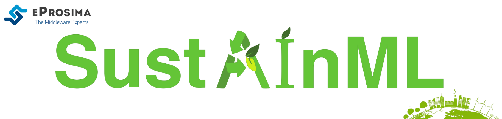

 

    <strong>
        <a href="https://eprosima.com/index.php/downloads-all">Download</a>
        &nbsp;&nbsp;•&nbsp;&nbsp;
        <a href="https://sustainml.readthedocs.io/en/latest">Docs</a>
        &nbsp;&nbsp;•&nbsp;&nbsp;
        <a href="https://sustainml.eu/showroom/news">News</a>
        &nbsp;&nbsp;•&nbsp;&nbsp;
        <a href="https://www.linkedin.com/company/eprosima/">LinkedIn</a>
        &nbsp;&nbsp;•&nbsp;&nbsp;
        <a href="mailto:info@eprosima.com">Contact Us</a>
    </strong>

  

    
    
    
    
    
    
    

  

*SustainML* is a framework and an associated toolkit that fosters energy efficiency throughout the life-cycle of ML applications.
Starting from a description of the user's problem and constraints, it proposes a machine learning model, estimates the resources that model needs on the chosen hardware, and the energy and carbon footprint of running it, so that different model and hardware choices can be compared.

AI developers from all experience levels can make use of the framework through its emphasis on human-centric interactive transparent design and functional knowledge cores, instead of the common blackbox and fully automated optimization approaches in AutoML.

---

## Project Architecture

The *SustainML Framework* is composed of six module nodes, each one specialized in one part of the problem, starting from the user's problem description:

1. **App Requirements** and **ML Model Metadata**: encode the problem and constraints defined by the user, and find the ML goal.
2. **ML Model Provider**: propose a machine learning model, or take the one chosen by the user.
3. **HW Constraints** and **HW Resources Provider**: evaluate the model on the hardware chosen by the user (latency, power and memory).
4. **Carbon Footprint**: estimate the energy and carbon footprint of each inference of the model on that hardware.

Each node is a Python program built on the Python API of this library, which hides the DDS communications.

### Library

This repository contains the library and the module nodes. It is not intended to be used or installed independently:
it is consumed by the SustainML Framework, which uses the library API to deploy the SustainML modules.
Information exchanged between modules is transmitted over DDS.

### Framework

The [SustainML Framework](https://github.com/eProsima/SustainML-Framework) includes a *Graphical User Interface* (GUI) through which the user defines the ML problem and explores the results.
The GUI talks through a REST API to the backend node of this repository, which hosts the **Orchestrator**: it feeds the module nodes with the information provided by the user and collects their results.

This process can be iterative.
So, based on a previous solution and the user's feedback, the framework provides new ML solutions.

---

## Repository Architecture

This repository is divided in sub-packages with different targets:

* `sustainml_cpp`: Main definition and implementation of the project logic library. C++ API provided.
* `sustainml_docs`: ReadTheDocs documentation project ([available here](https://sustainml.readthedocs.io/en/latest/))
* `sustainml_modules`: The module nodes and the backend node, written in Python on the Python API. The nodes of work packages 1, 2 and 3 are the `sustainml-wp1`, `sustainml-wp2` and `sustainml-wp3` Git submodules.
* `sustainml_py`: Python API of the library: Python classes that wrap the `sustainml_swig` bindings.
* `sustainml_swig`: SWIG bindings of the C++ API `sustainml_cpp`, built as the `sustainml_swig` Python module.

## Getting Help

If you need support you can reach us by mail at [sustainml@eprosima.com](mailto:sustainml@eprosima.com) or by phone at `+34 91 804 34 48`.

---

This project has received funding from the European Union’s Horizon Europe research and innovation programme (HORIZON-CL4-2021-HUMAN-01) under grant agreement No 101070408.
